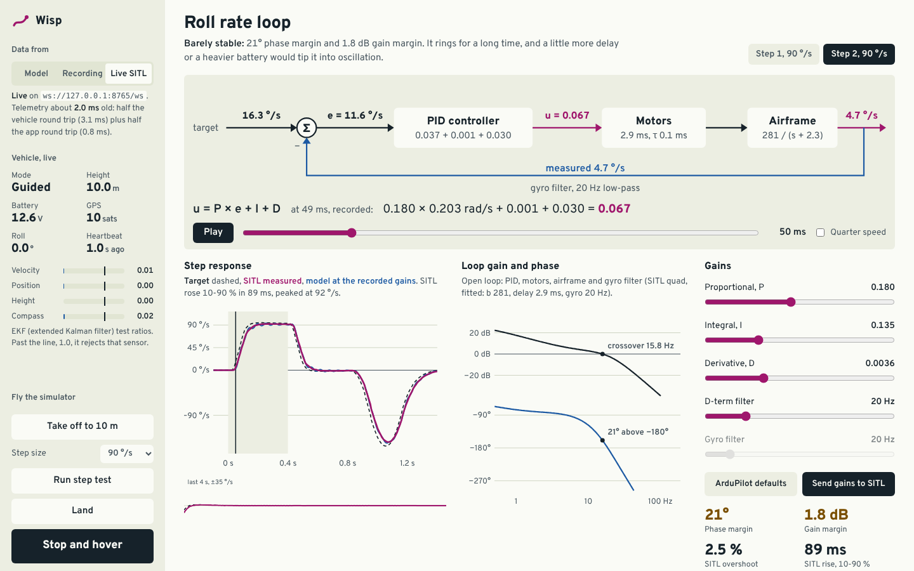
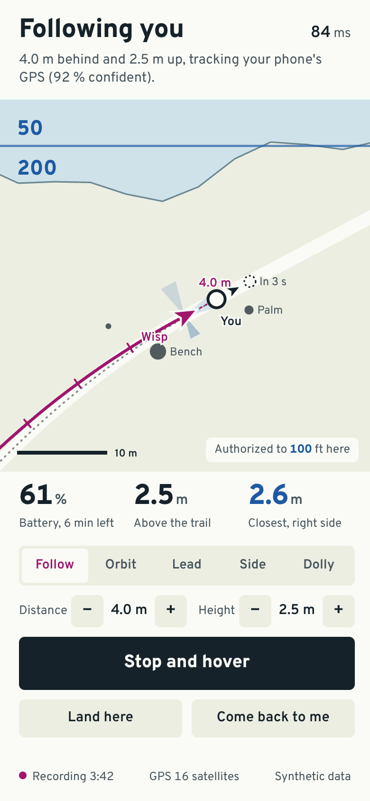
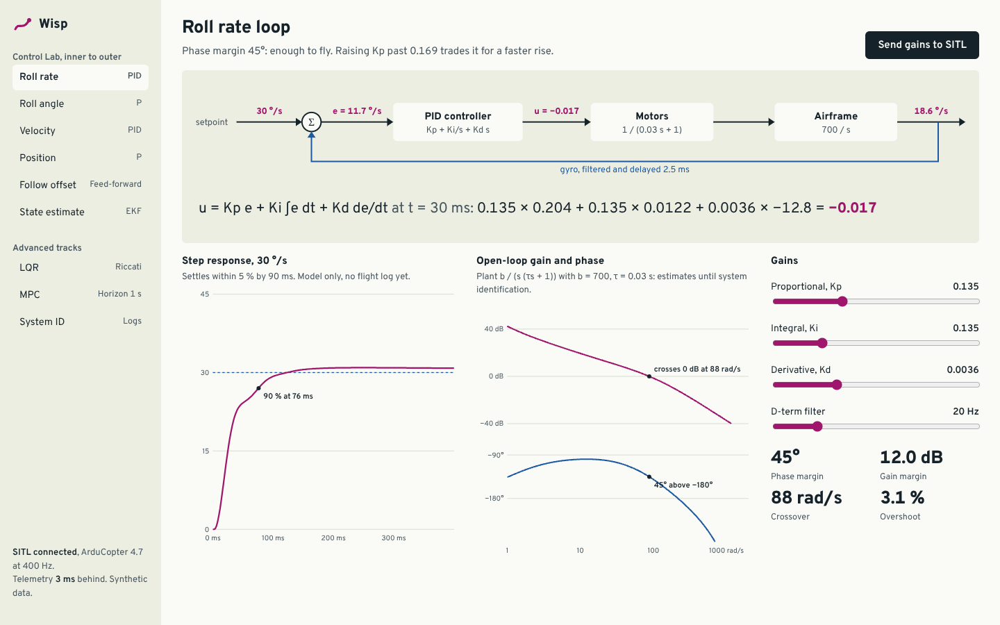

# Wisp: the pocket follow drone

  
  
  
  
  

Wisp is an open-source drone that knows where it is, avoids crashes and follows you while it films. It is built
from proven, bought parts, so each tier takes an afternoon, and the effort goes into flight software, control
theory and follow-me. It comes with a ground-control app and a site that teaches every algorithm visually.

> [!WARNING]
> **Nothing here has been built, bought or flown.** Wisp is planned by an AI agent and checked by its owner at a
> review gate after every phase. Phase 1 (simulation stack and Control Lab) is waiting for review:
> **[review/P1](review/P1/README.md)** (Phase 0: [review/P0](review/P0/README.md)). Every speed, mass and flight time
> below is an estimate.

## Two airframes, one software stack

"Smallest" and "films good footage while following you" pull against each other, so Wisp comes in two sizes:

| | Wisp Nano | Wisp Follow |
|---|---|---|
| What it is | A Crazyflie 2.1+ kit with optical-flow and ToF (time-of-flight) positioning and obstacle sensors | A 3 inch ducted quad running ArduPilot, with GPS (Global Positioning System), optical flow, lidar for avoidance and a companion computer for vision tracking |
| Mass | about 33-38 g | under 249.48 g with the battery: the Federal Aviation Administration (FAA) registration line for recreational flying |
| Good for | Indoor flying and control-theory experiments, the same day it arrives | Following you outdoors and filming |
| Top speed (estimate) | indoor | 45-61 mph; a 3.5 inch open-frame variant about 71-86 mph |
| Flight time (estimate) | up to 7 min | about 5 min a pack |

100 mph and long flights are out of reach for anything under the registration line: the reasons and the formulas
are in [review/P0/speed.md](review/P0/speed.md).

## Phase 1, in review: simulation stack and Control Lab

- A **ground bridge** between ArduPilot (MAVLink) and the apps, with latency shown and safety rules on what a page
  may command ([software/wisp_gcs](software/wisp_gcs/README.md)).
- The **Control Lab**: the roll-rate loop as a block diagram carrying live numbers, the PID equation with values
  substituted, step response and Bode plot, against a model, a recorded simulation or a live one
  ([docs/control-lab](https://normansrule.github.io/wisp/control-lab/)).
- **Step tests in ArduCopter 4.7.2 SITL** at three gain sets, and a loop model that predicts them, including
  that doubling the gains makes the loop unstable ([review/P1](review/P1/README.md)).

## Phase 0: research and design

- **Research with sources**: Crazyflie kits and decks, sub-250 g ArduPilot builds, ArduPilot follow-me and
  safety features, person tracking on small computers, and the FAA and Los Angeles rules
  ([review/P0/research](review/P0/research/)).
- **Parts lists and gram-by-gram budgets**, generated by a script so the totals add up
  ([review/P0/parts.md](review/P0/parts.md)).
- **Software architecture** and **Ubuntu commands** for ArduPilot SITL (software in the loop) and Gazebo. A first
  simulated follow-me flight has run: ArduCopter 4.7.2 followed a simulated walker for 60 s, a mean 3.85 m behind once settled
  ([review/P0/sitl.md](review/P0/sitl.md)).
- **Three visual concepts** for the app and site, each with a follow-me screen and a live Control Lab:
  [docs/concepts](https://normansrule.github.io/wisp/concepts/).

  
  

## Roadmap

| Phase | What | Status |
|---|---|---|
| 0 | Research, parts and weight budgets, architecture, three visual concepts | Done; open questions pending |
| 1 | SITL simulation stack and Control Lab basics | In review |
| 2 | Wisp Nano built and flying, with positioning and avoidance | Not started |
| 3 | Wisp Follow built, tuned and flying with GPS hold | Not started |
| 4 | Safety autopilot: avoidance, crash detection, failsafes | Not started |
| 5 | GPS follow-me, then vision follow-me | Not started |
| 6 | Advanced control: LQR (linear-quadratic regulator), MPC (model predictive control), system identification | Not started |
| 7 | App polish, website, release | Not started |

Simulation comes before hardware and a tether before free flight; no safety test is skipped.

## Also here

- **[Flight Lab](https://normansrule.github.io/wisp/lab/)**: a browser simulator with PID, LQR and MPC autopilots,
  reinforcement learning, an FPV (first-person view) camera and a flight recorder. It came from MicroScout and
  stays as the free-flying 3D playground next to the Control Lab ([docs/guide/lab.md](docs/guide/lab.md)).
- **[archive/microscout](archive/microscout/README.md)**: MicroScout, this repository's first project, a custom-PCB
  (printed circuit board) drone drafted through gates G1-G3. It is frozen; Wisp reuses its simulator, Flight Lab
  and control material.

## Safety and the law

Wisp is flown recreationally under 49 U.S.C. 44809: pass the free TRUST (The Recreational UAS Safety Test), keep it in sight (follow-me does not
change that), get LAANC (Low Altitude Authorization and Notification Capability) approval in controlled airspace (much of Los Angeles), stay at or below 400 ft, and weigh
it ready to fly. **A monetized vlog is not recreational flying** and falls under Part 107. Local rules close most
public land in San Pedro to hobby drones. Details and sources: [review/P0/research/law.md](review/P0/research/law.md).
This is not legal advice. Charge and store LiPo (lithium-polymer) batteries in a fire-safe bag, and never leave them charging
unattended.

## Licences

Software MIT, documentation CC-BY-SA-4.0, future hardware CERN-OHL-S-2.0 and firmware GPL-3.0: [LICENSES.md](LICENSES.md).
