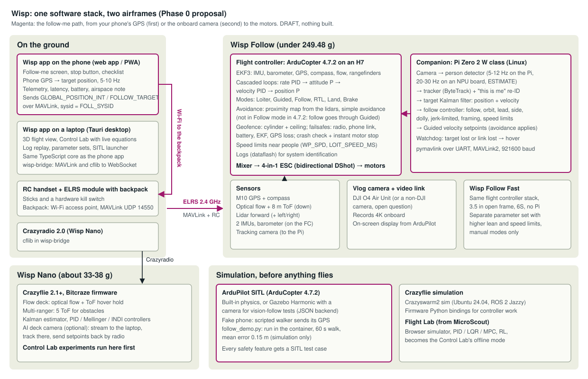

> STATUS: DRAFT - UNVERIFIED - requires human review at the Phase 0 gate

# Wisp, Phase 0 gate: research, parts, architecture, visual concepts

Phase 0 of `wisp-project-context.md`. **Nothing has been ordered, built or flown.** Approve with "APPROVED P0", or
answer the open questions below first. Research date for every price, stock status and rule: 2026-10-26.

| Deliverable | Where |
|---|---|
| Research with sources (6 topics) | [`research/`](research/) |
| Parts lists and gram-by-gram weight budgets (generated, totals computed) | [`parts.md`](parts.md), [`parts/*.csv`](parts/), [`calc/budget.py`](calc/budget.py) |
| Top speed and flight time, with formulas | [`speed.md`](speed.md), [`calc/speed.py`](calc/speed.py) |
| Software architecture | [`architecture.svg`](architecture.svg) and below |
| Ubuntu commands: ArduPilot SITL (software in the loop), Gazebo, a first simulated follow-me flight | [`sitl.md`](sitl.md), [`../../software/wisp_sitl/`](../../software/wisp_sitl/) |
| Three visual concepts with follow-me and Control Lab mockups | [`../../docs/concepts/`](../../docs/concepts/index.html), process and audit in [`concepts.md`](concepts.md) |

## What the research found

**1. 100 mph is not reachable under the registration limit; the honest ceiling is about 60 mph ducted or 86 mph
open.** No GPS-logged top speed was found for any sub-250 g 3-3.5 inch quad, so these are physics estimates
([`speed.md`](speed.md)): the ducted vlog build about 73-98 km/h (45-61 mph); a 3.5 inch open-frame 6S build
114-139 km/h (71-86 mph). Small props hit their pitch speed before drag stops them, so more battery voltage buys
little. Flight time is **5-7 minutes a pack**; two hours would need about 600 g of the best cells.

**2. The registration line is 249.48 g, not 250 g.** 14 CFR 48.15(b): "0.55 pounds or less on takeoff, including
everything that is on board or otherwise attached" (quoted from a non-government copy; not yet read on eCFR, so
the exact wording is UNCONFIRMED). Under it, flown strictly for fun under 49 U.S.C. 44809: no
registration, no marking, no Remote ID. TRUST (The Recreational UAS Safety Test), line of sight, LAANC (Low Altitude Authorization and
Notification Capability) in controlled airspace and 400 ft in Class G
still apply. There is no recreational speed limit (Part 107's 100 mph does not apply), but line of sight and the
ban on careless flight do. ([`research/law.md`](research/law.md))

**3. A monetized vlog is not recreational.** AC 91-57D: recreational purposes "may not include activities such as
flights for any compensation, monetary or otherwise". If the channel earns money, the flights fall under Part 107:
a Remote Pilot Certificate, and registration and Remote ID whatever the weight.

**4. San Pedro's public land is close to closed to hobby drones.** City parks ban them except in set-aside areas
(Los Angeles Municipal Code (LAMC) 63.44 B.8); Port of Los Angeles police say no Harbor Department land is set aside; LA County beaches ban them
(County Code 17.12.425); FCI Terminal Island and the Coast Guard base (exact location UNCONFIRMED) are restricted from the surface to 400 ft.
Private land with the owner's permission is the practical option. The airspace ceilings around Point Fermin were
not reachable from here: check B4UFLY or a LAANC app on site.

**5. ArduCopter 4.7.2 (the current stable release) changes the follow-me design.** Verified in its source:
Follow mode does no obstacle avoidance, `FOLL_SYSID` must be set (0 follows nothing), and the crash check needs
about 2 s of lost attitude. So Wisp follows by streaming Guided velocity setpoints from the companion computer
(simple avoidance applies there), keeps Follow mode as the fallback, and cuts motors instantly with a switch
(`RCx_OPTION` 31) or a MAVLink (Micro Air Vehicle Link protocol) force-disarm. ([`research/ardupilot.md`](research/ardupilot.md))

**6. Sourcing is fragile.** Sold out today: the only ducted 3 inch frame light enough (GEPRC CineLog30 V3), both
3.5 inch open frames, the Raspberry Pi Zero 2 W at Adafruit and SparkFun, the Crazyflie AI deck at Bitcraze.
On 2025-12-22 the Federal Communications Commission (FCC) put foreign-made drones and drone components (flight controllers, motors, cameras,
radios, batteries) on its Covered List: models already authorized can still be sold, new ones cannot be
authorized. DJI, maker of the O4 camera in the vlog build, is listed separately.

**7. Vision tracking on a Pi Zero 2 W is slow.** Published third-party benchmarks (not run here): Yolo-FastestV2 at 12 frames a second (inference only),
with low accuracy; the YOLOv8n class at 640 px runs at about 1 frame a second. A board with an NPU (neural
processing unit), such as the Radxa ZERO 3W (RK3566, YOLOv8n 35 frames a second at 640 px, Rockchip's figure), is
the better companion, but its mass is unconfirmed. ([`research/vision.md`](research/vision.md))

**8. The Crazyflie's AI deck cannot run its own trackers for now.** Its chip maker (GreenWaves) went into
liquidation in 2025 and a tool its neural-network examples need is no longer downloadable. Stream the camera to
the laptop and track there. ([`research/nano.md`](research/nano.md))

## Proposed builds

| | Wisp Nano | Wisp Follow | Wisp Follow Fast |
|---|---|---|---|
| Airframe | Crazyflie 2.1+ (brushed) | 3 inch ducted, 4S | 3.5 inch open, 6S, removable guards |
| Flight stack | Bitcraze firmware | ArduCopter 4.7.2 on an H7 all-in-one board | Same, separate parameter set |
| Positioning | Flow deck (optical flow + ToF, time-of-flight height) | GPS + compass, flow + ToF, forward lidar | Same, no companion |
| Tracking | Laptop, from the optional AI deck's stream | Companion computer + camera, phone GPS first | Phone GPS only |
| Takeoff mass (budget) | 33.4 g (37.8 g with the AI deck) | 241.5 g (245.5 g with side lidars) | 229.8 g; 240.0 g guarded on 6S 450 |
| Top speed (estimate) | indoor | 45-61 mph | 71-86 mph open, 65-76 mph guarded |
| Flight time (estimate) | under 7 min (stock 7 min) | about 5 min | about 5.5-7 min |
| Parts cost (priced items) | $425, or $665 with the AI deck | $370.83 + unpriced items | $233.80 + unpriced items |

Full tables, stock, suppliers and the basis of every gram: [`parts.md`](parts.md). The Follow budget has 8 g of
margin and rests partly on estimates: weigh the frame, motors, props and battery (75 % of the mass) before buying
the electronics.

## Software architecture

- **One stack, two flight controllers.** Wisp Nano runs the Bitcraze firmware through cflib; Wisp Follow runs
  ArduCopter. A small bridge (`wisp-bridge`, Python) turns MAVLink and cflib into one WebSocket stream, so the app
  does not care which drone it talks to.
- **The app** is one TypeScript code base: a phone web app (the follow-me screen, sending the phone's GPS as the
  target), a Tauri desktop app (3D view, Control Lab, log replay) and the GitHub Pages site. The MicroScout Flight
  Lab becomes the Control Lab's offline mode.
- **Links.** RC and MAVLink share one ExpressLRS radio link; the handset's backpack gives the phone a Wi-Fi hop to
  it. Every stop command has two paths: the app (MAVLink) and a hardware switch on the handset.
- **The companion computer** runs the vision pipeline (detector → tracker → "this is me" re-identification →
  Kalman filter on your position and velocity) and the follow controller (follow, orbit, lead, side, dolly), and
  commands ArduPilot with Guided velocity setpoints. If the target or the link is lost, it stops and hovers.
- **Simulation first.** ArduPilot SITL (headless, or with Gazebo Harmonic for camera tests), a scripted "phone",
  and the Crazyflie simulators. `follow_demo.py` already flew a 60 s simulated follow-me run here: mean position
  error 0.15 m ([`sitl.md`](sitl.md)). Every safety feature gets a SITL test before a tethered test.

## Visual concepts

Sectional (the aviation chart), Monitor (the film-set field monitor) and Tower (the Los Angeles lifeguard tower):
[`docs/concepts/index.html`](../../docs/concepts/index.html). The recommendation is **Sectional** for the app. The
Impeccable launcher was not run (it downloads a binary), so its automated steps were done by hand; the audit
scored each concept 13/20, with responsive behaviour the weak point, as expected for fixed-size mockups
([`concepts.md`](concepts.md)).

## Open questions

| # | Question | Recommendation |
|---|---|---|
| OQ-W1 | Will the vlog earn money (ads, sponsors)? If yes, flights are Part 107: certificate, registration and Remote ID at any weight. | Decide before the first outdoor flight. If commercial, take the Part 107 test; the sub-250 g build still keeps the drone light and safer. |
| OQ-W2 | Speed: accept about 60 mph for the ducted follow drone, and build the 3.5 inch Fast drone as a second airframe for speed runs (about 71-86 mph, estimated)? | Yes, as a later tier (after Phase 3), flown only in manual modes, never in follow-me. |
| OQ-W3 | Where will you fly? San Pedro's city, port and county land is mostly closed to hobby drones. | Find private land with permission, or a club field, and check B4UFLY there. Indoor flying is unaffected. |
| OQ-W4 | Vlog camera: DJI O4 Air Unit (8-9 g, best footage, DJI is on the FCC list and US stock is unclear) or a non-DJI camera (RunCam Thumb Pro W, 16 g, would need weight savings elsewhere)? | O4 if a US dealer has authorized stock; otherwise the RunCam with the 450 mAh pack. |
| OQ-W5 | Companion: Pi Zero 2 W (10 g, slow, out of stock) or an NPU board (Radxa ZERO 3W, faster, mass unconfirmed)? | Weigh a Radxa ZERO 3W before deciding; start GPS follow without any companion. |
| OQ-W6 | Wisp Nano: Crazyflie 2.1+ (33-38 g, $425-665) or the Brushless (about 43 g fitted, 40 g payload, about $666 with spares, or $906 with the AI deck)? AI deck now or later? | 2.1+ with the STEM ranging bundle now; AI deck later, if Bitcraze restores its toolchain. |
| OQ-W7 | Visual concept: Sectional, Monitor, Tower, or a mix? | Sectional for the app; the website can be bolder. |
| OQ-W8 | Repository name: the repo is renamed to `wisp` in the files; the GitHub rename itself needs your account (Settings → General → Repository name), since this session's GitHub token is not valid. | Rename it; GitHub redirects the old links. |
| OQ-W9 | The flight controller's ArduPilot target: the MicoAir H743 v2 all-in-one board's target is named only by a retailer, and the `MicoAir743v2` definition in ArduPilot describes the 30 × 30 mm board. | Ask MicoAir before buying, or fall back to the NxtPX4v2 (documented target) with a separate ESC (electronic speed controller). |

## What was and was not verified

- **Run here:** ArduCopter 4.7.2 built for SITL and a 60 s follow-me flight (`sitl.md`); the parts and speed
  calculations (`calc/`); the six mockups rendered and contrast-checked; the ArduPilot parameter names and the
  rangefinder driver checked in the 4.7.2 source.
- **Not run here:** the ArduPilot prerequisite script, Gazebo (its package server was blocked), the Crazyflie
  simulators, the Impeccable and taste-skill automated tools.
- **From sources, not tested:** every price, stock status, mass and legal rule. Each research note marks what it
  could not reach as UNCONFIRMED. Several official sites (ardupilot.org, expresslrs.org, eCFR section pages, the
  FAA facility-map service) were unreachable, and the web-search budget ran out before some local checks.
