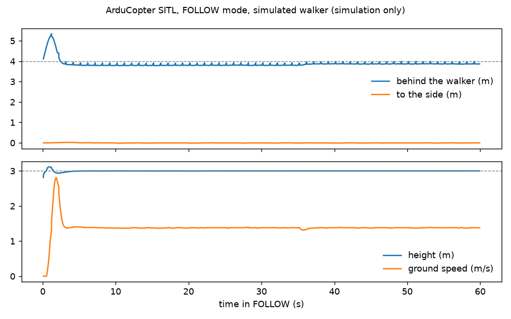

> STATUS: DRAFT - UNVERIFIED - requires human review at the Phase 0 gate

# Simulation setup: ArduPilot SITL, Gazebo and a first simulated follow-me flight (Ubuntu 24.04)

SITL (software in the loop) runs the real ArduCopter flight code on your computer against a simulated drone.
Everything Wisp does is tried here before it flies.

**What was run for this gate, in a cloud container (Ubuntu 24.04.5, 2 cores):** steps 1-3 and step 5, with a
Python virtual environment in place of the prerequisite script. **Not run here:** the prerequisite script (step 2a)
and Gazebo (step 6); the Gazebo package server was blocked from the container, so those commands come from the
ArduPilot and Gazebo documentation and are UNCONFIRMED until you run them.

## 1. Get ArduPilot at the current stable release

ArduCopter 4.7.2 is the current stable release (tag `Copter-4.7.2`, commit `fb77356`, the same commit as the
`ArduCopter-stable` tag; `research/ardupilot.md` §1).

```bash
sudo apt update && sudo apt install -y git build-essential python3-venv
git clone --depth 1 --recurse-submodules --shallow-submodules -b Copter-4.7.2 \
    https://github.com/ArduPilot/ardupilot.git ~/ardupilot
```

## 2. Install the build and simulation tools

**2a. The official way** (installs everything, including the ARM compilers for real boards, into `~/venv-ardupilot`):

```bash
cd ~/ardupilot
Tools/environment_install/install-prereqs-ubuntu.sh -y
. ~/.profile
```

**2b. The minimal way used here** (SITL only):

```bash
python3 -m venv ~/venv-ardupilot && . ~/venv-ardupilot/bin/activate
pip install empy==3.3.4 pexpect future dronecan MAVProxy pymavlink setuptools lxml matplotlib
```

## 3. Build ArduCopter for SITL

```bash
cd ~/ardupilot
./waf configure --board sitl
./waf copter          # 8 min 10 s on 2 cores here; builds build/sitl/bin/arducopter
```

## 4. Fly it by hand (optional)

```bash
cd ~/ardupilot/ArduCopter
sim_vehicle.py -v ArduCopter --console --map -w      # -w wipes parameters on the first run
```

In the MAVProxy console: `mode guided`, `arm throttle`, `takeoff 5`, then `mode land`.

## 5. The first simulated follow-me flight

`software/wisp_sitl/follow_demo.py` starts the SITL binary itself, plays a phone walking along a cliff-top trail at
1.4 m/s, and records where the drone sits. The walker's position goes out as MAVLink (Micro Air Vehicle Link protocol) `GLOBAL_POSITION_INT` from
system id 255, the way the Wisp app will send the phone's GPS.

```bash
. ~/venv-ardupilot/bin/activate
cd ~/wisp       # this repository
python3 software/wisp_sitl/follow_demo.py --ardupilot ~/ardupilot --out sitl-out
```

What it sets (ArduCopter 4.7.2 names):

| Parameter | Value | Why |
|---|---|---|
| `FOLL_ENABLE` | 1 | Follow mode on |
| `FOLL_SYSID` | 255 | Whose position to follow. **Since 4.7.2 there is no auto-detect: 0 follows nothing** |
| `FOLL_OFS_TYPE` | 1 | Offsets turn with the walker's heading |
| `FOLL_OFS_X` | −4 | 4 m behind |
| `FOLL_OFS_Z` | −3 | 3 m above (z points down). With 0 the drone descends to the phone's height |
| `FOLL_ALT_TYPE` | 1 | Heights relative to home |
| `FOLL_YAW_BEHAVE` | 1 | Face the walker |

Result of the run in the container (`sitl/summary.txt`, chart `sitl/follow_demo.png`, log `sitl/follow_demo.csv`):

> after 20 s: mean 3.85 m behind (want 4.0), side 0.02 m at most, height 3.00 m (want 3.0), speed 1.38 m/s
> (walker 1.4); position error mean 0.15 m, max 0.21 m

This shows the plumbing works: a phone-style position stream drives ArduCopter's Follow mode in simulation. It
says nothing about a real drone, wind, GPS error or a real phone's 1-5 m position noise.



**Two findings that change the design** (from the 4.7.2 source, `research/ardupilot.md` §2-3):

1. **Follow mode does no obstacle avoidance in 4.7.2.** Simple avoidance only acts on Guided velocity commands
   (`SET_POSITION_TARGET_LOCAL_NED` with velocity only). So Wisp's follow-me will run on the companion computer and
   steer through Guided velocity setpoints at 10-20 Hz, with Follow mode kept as the simple fallback. The same path
   gives the orbit, lead, side and dolly moves.
2. **The crash check is slow** (about 2 s of lost attitude before it disarms). The instant motor cut comes from a
   switch (`RCx_OPTION` 31, motor emergency stop) and a MAVLink force-disarm from the app or the companion.

## 6. Gazebo Harmonic, for camera-based tracking tests (UNCONFIRMED: not run here)

From gazebosim.org and the `ardupilot_gazebo` README (Harmonic is the version the plugin recommends; ROS 2 (Robot Operating System 2) is not
needed):

```bash
sudo apt-get update && sudo apt-get install -y curl lsb-release gnupg
sudo curl https://packages.osrfoundation.org/gazebo.gpg --output /usr/share/keyrings/pkgs-osrf-archive-keyring.gpg
echo "deb [arch=$(dpkg --print-architecture) signed-by=/usr/share/keyrings/pkgs-osrf-archive-keyring.gpg] https://packages.osrfoundation.org/gazebo/ubuntu-stable $(lsb_release -cs) main" | sudo tee /etc/apt/sources.list.d/gazebo-stable.list > /dev/null
sudo apt-get update && sudo apt-get install -y gz-harmonic libgz-sim8-dev rapidjson-dev \
    libopencv-dev libgstreamer1.0-dev libgstreamer-plugins-base1.0-dev gstreamer1.0-plugins-bad gstreamer1.0-libav gstreamer1.0-gl
git clone https://github.com/ArduPilot/ardupilot_gazebo ~/ardupilot_gazebo
cd ~/ardupilot_gazebo && mkdir -p build && cd build
GZ_VERSION=harmonic cmake .. -DCMAKE_BUILD_TYPE=RelWithDebInfo && make -j4
echo 'export GZ_SIM_SYSTEM_PLUGIN_PATH=$HOME/ardupilot_gazebo/build:${GZ_SIM_SYSTEM_PLUGIN_PATH}' >> ~/.bashrc
echo 'export GZ_SIM_RESOURCE_PATH=$HOME/ardupilot_gazebo/models:$HOME/ardupilot_gazebo/worlds:${GZ_SIM_RESOURCE_PATH}' >> ~/.bashrc
source ~/.bashrc
```

Run it in two terminals:

```bash
gz sim -v4 -r iris_runway.sdf                                                   # terminal 1
cd ~/ardupilot/ArduCopter && sim_vehicle.py -v ArduCopter -f gazebo-iris --model JSON --map --console   # terminal 2
```

The `iris_runway` world carries a gimbal camera that streams H.264 to UDP port 5600; the tracker can read that
stream in place of the drone's camera. A walking-person model for the world is a Phase 1 task.

## 7. The Crazyflie side (Wisp Nano)

Crazyswarm2's simulator supports Ubuntu 24.04 with ROS 2 Jazzy and runs the real firmware code; the Bitcraze
Python library and client install in a virtual environment on Python 3.12 (`research/nano.md` §3-4; the client
install was tried there, the simulator was not). Setup commands come with Phase 1.
