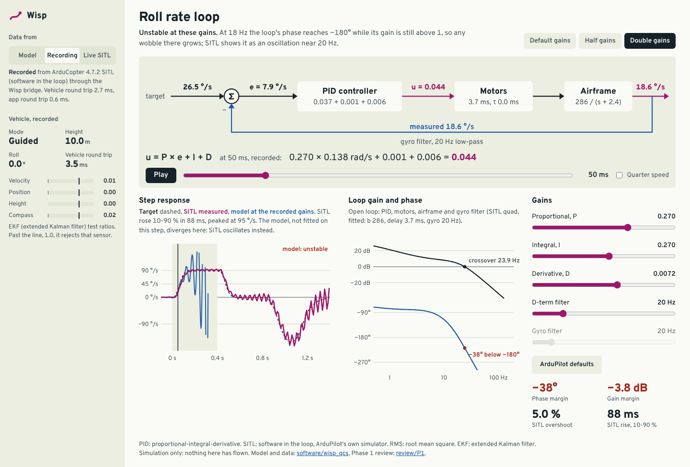
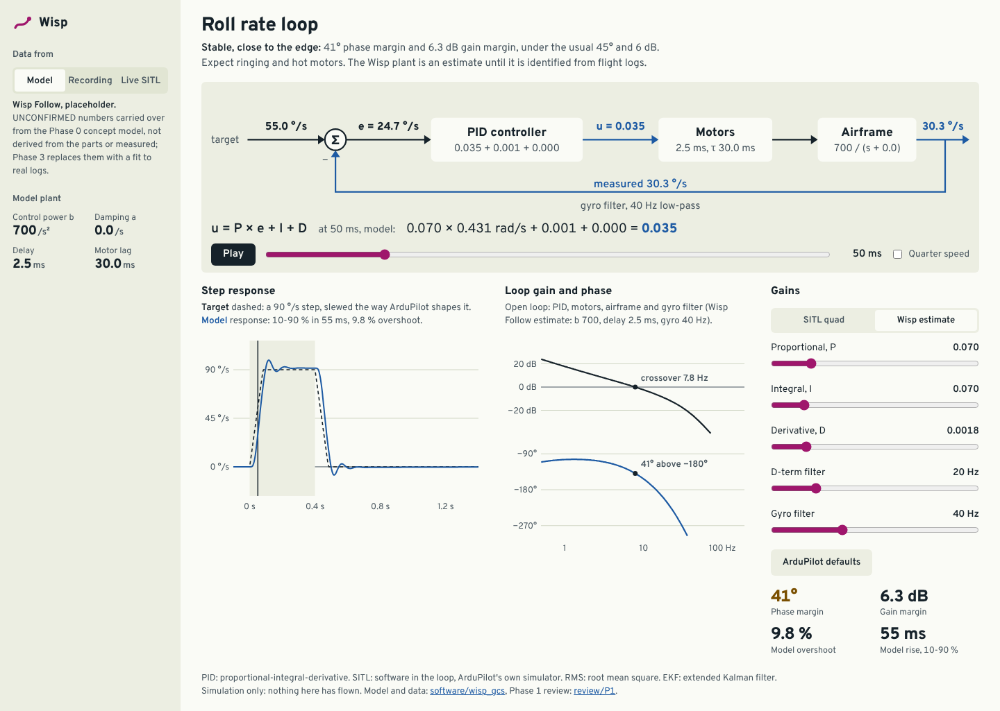

# Phase 1 review: simulation stack and Control Lab

> **STATUS: DRAFT, waiting for the owner's review at the Phase 1 gate.** Everything here ran in ArduCopter 4.7.2
> SITL (software in the loop, ArduPilot's own simulator) in a cloud container. Nothing has been bought, built or
> flown, and nothing here says how a real Wisp will fly. Numbers measured in the simulator are marked SITL;
> numbers from the fitted loop model are marked ESTIMATE.

**Gate decision needed:** approve Phase 1, answer the open questions below, and say whether to order the Wisp
Nano parts for Phase 2. Nothing will be ordered without that.

## What Phase 1 delivers

| Deliverable | Where |
|---|---|
| Ground bridge: MAVLink (Micro Air Vehicle Link) to WebSocket, latency measurement, commands with safety rules, recording | [`software/wisp_gcs/bridge.py`](../../software/wisp_gcs/bridge.py) |
| Rate-loop step test, scoring, plant fit, stability margins | [`steptest.py`](../../software/wisp_gcs/steptest.py), [`fit.py`](../../software/wisp_gcs/fit.py) |
| Control Lab: the roll-rate PID (proportional-integral-derivative) loop as a block diagram carrying live numbers, the PID equation with values substituted, step response, Bode plot, gains | [`docs/control-lab`](../../docs/control-lab/) |
| A recorded SITL session the Control Lab replays without a simulator | [`sitl/`](sitl/), [`docs/control-lab/data`](../../docs/control-lab/data/) |
| Ubuntu commands for the whole stack | [`software/wisp_gcs/README.md`](../../software/wisp_gcs/README.md) |
| Tests: 36 unit, 1 end to end against SITL, 5 that hold the JavaScript model to the Python one | [`software/wisp_gcs/tests`](../../software/wisp_gcs/tests/), [`docs/control-lab/test`](../../docs/control-lab/test/) |
| A recording of the Control Lab flying SITL in a browser (76 s) | [`media/control-lab-live-sitl.mp4`](media/control-lab-live-sitl.mp4) |

  

The Control Lab has three sources, all on the same screen:

- **Model**: the loop model alone, on the SITL plant fitted below or on a Wisp Follow placeholder.
- **Recording**: three roll-rate steps recorded from SITL through the bridge, played back with a scrubber. Works
  from GitHub Pages or any static server.
- **Live SITL**: the bridge serves the page at `http://127.0.0.1:8765/control-lab/`. Take off, run a step test,
  move the gains, send them to SITL, compare. **Stop and hover** (or the Escape key) is always one press away.

## What the simulator showed

All figures below come from the committed recording [`sitl/recording.jsonl.gz`](sitl/recording.jsonl.gz) and its
summary [`sitl/session.json`](sitl/session.json) unless a row says otherwise.

**1. ArduCopter's default roll-rate gains sit close to the edge on SITL's quad (SITL).** The same 90 °/s
roll-rate step at three gain sets, scored from the PID_TUNING stream (100 samples a second):

| Gains (P, I, D) | Rise 10-90 % | Overshoot | Settles within 5 % | Tracking error, RMS (root mean square) | Jitter after the rise |
|---|---:|---:|---:|---:|---:|
| Half (0.0675, 0.0675, 0.0018) | 115 ms | 6.5 % | not within the step | 17.4 °/s | 4.4 °/s |
| Default (0.135, 0.135, 0.0036) | 94 ms | 3.4 % | 164 ms | 9.2 °/s | 4.7 °/s |
| Double (0.27, 0.27, 0.0072) | 88 ms | 5.0 % | 402 ms | 5.1 °/s | **17.7 °/s** |

Jitter is the RMS of the sample-to-sample change in the measured rate after the rise. At double gains SITL
oscillates near 20 Hz in every run so far (five), most strongly while the attitude loop levels the drone after the
step; how big the oscillation is varies from run to run, so overshoot alone (5-64 % across the runs) is a poor
measure of it. These are numbers for SITL's generic quad, not for Wisp.

**2. A small loop model reproduces SITL and predicts the instability (ESTIMATE).** PID, a delay, a motor lag, the
airframe b / (s + a) and ArduPilot's 20 Hz gyro filter, fitted by simulating the closed loop
([`fit.py`](../../software/wisp_gcs/fit.py)):

- Fitted on the default and half steps: b = 286 /s², a = 2.4 /s, delay 3.7 ms, motor lag too short for 100 Hz
  data to resolve; it tracks those two steps to 0.8 and 0.9 °/s RMS.
- **Out of sample:** fitted on the default step alone, it predicts the half-gain step to **1.4 °/s RMS** and
  predicts the double gains **unstable** (negative phase margin), which matches SITL's oscillation.
- Its first version left out the gyro filter and predicted double gains to be fine. Adding the filter is what made
  it right: at these frequencies it is the biggest source of lag in the loop.

**3. The margins are a range, not one number (ESTIMATE).** At the default gains the two fits give a crossover at
13.5-14.5 Hz, phase margin **30-50°** and gain margin **2.2-4.5 dB**. They differ because 100 samples a second pin
the delay down only loosely (1.3-3.7 ms). Phase 6 should identify the plant from the flight controller's 400 Hz
logs instead.

**4. Wisp Follow's starting gains are still a guess (UNCONFIRMED).** The Model mode includes a Wisp Follow plant,
but its numbers (b = 700 /s², 30 ms motor lag, 2.5 ms delay, 40 Hz gyro filter) are placeholders carried over
from the Phase 0 concept mockup, not derived from the Phase 0 parts or measured. On them, ArduPilot's default gains
leave 3° of phase margin and about half the defaults (0.07, 0.07, 0.0018) give 41° and 6.3 dB. Treat that only as
a reason to start low; Phase 3 replaces the placeholders with a fit to Wisp's own logs.

**5. Stop works, after two fixes.** The first scripted session found that a stop sent during a step test waited
until the test finished, because the bridge handled each app's commands one at a time. The independent check then
found that a stop arriving just before a step began could be lost. Now a stop counts the moment it arrives and
cancels anything received before it: the step test aborts within **11 ms**, the vehicle confirms Brake mode, and it
is moving at 0.2 m/s 2.5 s later (SITL). If Brake is refused, the bridge asks for Land and says so.

**6. Latency is shown, and small on one computer (SITL).** Vehicle round trip (MAVLink TIMESYNC) 1.7-12.7 ms,
median 3.2 ms; app round trip (WebSocket ping) median 0.6 ms in the scripted session. The newest attitude sample
waits a median 10 ms (95 % under 21 ms) in the bridge before it is sent, so attitude on screen is typically
12-23 ms old. The Control Lab shows that sum live. A radio link will add much more (Phase 3).

**7. Timestamps needed care.** PID_TUNING carries no time of its own, so the bridge stamps it on arrival. When the
computer was busy (SITL, browser and screen recording at once) samples arrived in bursts and a step looked like a
staircase: rise read as 125 ms instead of about 95 ms ([`sitl/before-dejitter.jsonl.gz`](sitl/before-dejitter.jsonl.gz)).
The bridge now spreads such bursts at the stream's measured period (`Dejitter`, tested at 100 Hz and with uneven
arrivals); the next browser run read 95 ms ([`sitl/browser-run.jsonl.gz`](sitl/browser-run.jsonl.gz)).

## What was checked, and how

| Check | Result | Evidence |
|---|---|---|
| Scripted session through the bridge: take-off, 3 steps, stop mid-step, two refused parameter writes, land | Passed | [`sitl/session.json`](sitl/session.json) |
| End-to-end test against SITL | Passed (105-117 s, before and after the fixes) | [`tests/test_sitl.py`](../../software/wisp_gcs/tests/test_sitl.py), run locally; skipped in CI (continuous integration), which has no ArduPilot build |
| Unit tests: telemetry, `Dejitter`, step plan and score, filter, fit recovers a known plant, margins, the replay file rebuilds, parameter rules while armed, stop cancels a pending step, Brake falls back to Land, static files stay inside `docs/`, Origin check | 36 passed | [`tests/test_gcs.py`](../../software/wisp_gcs/tests/test_gcs.py) |
| JavaScript model against Python | 5 passed: closed loop to 1 part in 10⁶, margins to 0.2 %, scores to 0.1-2 % | [`docs/control-lab/test`](../../docs/control-lab/test/) |
| Browser run (Playwright, Chromium) against SITL: take off, step, play, send gains, second step, stop mid-step, land | No page errors; default step 95 ms rise, 3.4 % overshoot; with P 0.18, 86 ms and 2.6 % | [`checks/browser-run.txt`](checks/browser-run.txt), [`sitl/browser-run.jsonl.gz`](sitl/browser-run.jsonl.gz), video |
| Accessibility: axe-core 4.10.2, WCAG (Web Content Accessibility Guidelines) 2.2 A and AA rules plus best practice, on Model, Recording and Live at 1440 px and Recording at 390 px | 0 violations, after fixing heading order, two ARIA (Accessible Rich Internet Applications) labels and a scroll region | [`checks/axe.txt`](checks/axe.txt) |
| Touch targets at 390 px | All controls 44 px or taller, except inline links (exempt) and the skip link (shown only on focus) | [`checks/axe.txt`](checks/axe.txt) |
| Frame rate of the live view, headless Chromium with software rendering (no GPU, graphics processor), while SITL also ran | 55 frames a second in the final run (43-59 in earlier runs, not kept) | [`checks/browser-run.txt`](checks/browser-run.txt) |

An independent review of this package (an agent that had not seen the work) found two safety bugs in the bridge,
a wrong sample rate and an understated telemetry age, among others; all are fixed above and in the code:

- **Origin check:** the bridge accepted the Origin "null", which any website can produce from a sandboxed frame.
  It is now refused.
- **Armed parameter rules:** the 4x limit was skipped for a parameter that was 0 or unreadable. Those are now
  refused in flight, and every parameter has an absolute ceiling, armed or not.
- **End of a step test:** the step test forced Guided mode at its end, which could undo a Land or a failsafe and
  let the drone drift about 12 m a step. It now aborts if the mode changes, and finishes by braking before holding
  position.
- **Position-controller names:** the allowlist used old names; it now uses the 4.7.2 ones (`PSC_NE_VEL_P`).
- **Ground-station heartbeat:** the bridge now sends one, so ArduPilot's ground-station-loss failsafe can work.

## Not done, or not verified

- **Gazebo** is still not installed: its package host is blocked from this container. Everything used SITL's own
  physics. The Ubuntu commands are in [`review/P0/sitl.md`](../P0/sitl.md) but have not been run here.
- **Only the roll-rate loop** is in the Control Lab. Angle, velocity and position loops (the rest of the cascade)
  come with Phases 3-5; pitch and yaw use the same code but were not step-tested.
- **The Crazyflie simulator** for Wisp Nano is not set up yet.
- **Live SITL from the GitHub Pages site** (an https page reaching `ws://127.0.0.1`) is UNCONFIRMED: browsers may
  block it (Chrome's Private Network Access rules). The supported way is the page the bridge serves.
- **The Impeccable detector** did not run: its launcher downloads a platform binary, and that host is blocked.
  The audit below follows its rubric by hand, with axe-core for the automated part.
- **No 3D view** in the Control Lab yet. The 60-frames-a-second rule for 3D views applies when one is added (the
  Flight Lab already has one); the live 2D strip chart was measured above.
- **Nothing ran against a real vehicle.** The bridge's rules were designed and tested for SITL (see OQ-P1-3).

## Design audit (Impeccable rubric, by hand)

| # | Dimension | Score | Key finding |
|---|---|---:|---|
| 1 | Accessibility | 4 | axe-core clean in all four views; native controls throughout; Escape stops |
| 2 | Performance | 3 | Small SVG (scalable vector graphics) redraws on input; the animation loop keeps running when idle (cheap, but could sleep) |
| 3 | Theming | 3 | All colours are tokens, and the canvas reads them too; light only, on purpose (read in daylight, Sectional concept) |
| 4 | Responsive | 3 | Works from 390 px up with no sideways page scroll; on phones the block diagram scrolls sideways in its own panel |
| 5 | Implementation integrity | 4 | Every number on screen is computed from the model or recorded data, and labelled model, recorded or live |
| | **Total** | **17/20** | Good |

Concept rules kept: one magenta for the vehicle's own motion, airspace blue for the model, sensors and limits,
ink for targets; no legends, each line named in the sentence above its chart; Overpass throughout; press feedback
at scale 0.97 with an ease-out curve, off under reduced motion.

## Open questions

OQ means open question; OQ-W numbers are the Phase 0 ones in [review/P0](../P0/README.md).

| # | Question | Recommendation |
|---|---|---|
| OQ-P1-1 | **Order the Wisp Nano parts for Phase 2?** Crazyflie 2.1+ STEM ranging bundle ($410, Bitcraze) plus spare batteries; price and stock from Phase 0, to be rechecked before ordering. | Yes, after you confirm OQ-W6. I will recheck stock and price and wait for your go before any order. |
| OQ-P1-2 | The Phase 0 questions are still open (OQ-W1 to W9). Phase 1 used the recommended defaults, including the Sectional design (OQ-W7). Phase 2 needs OQ-W6 (which Crazyflie). | Answer OQ-W6 and OQ-W7 now; the others can wait until Phase 3. |
| OQ-P1-3 | Gain limits for a real vehicle. The bridge refuses more than 4x per step while armed and has absolute ceilings, but two 4x steps can still reach gains that make SITL oscillate. | Before Phase 3, also limit armed changes to 0.5x-1.5x of the values at arming; wider only when disarmed. |
| OQ-P1-4 | Live mode from the public Pages site, or only from the page the bridge serves? | Only from the bridge's page: no cross-site path into a computer that commands a drone. |
| OQ-P1-5 | Wisp Follow's first gains: start at about half of ArduPilot's defaults, as finding 4 suggests? | Yes, for the first tethered hover only; then ArduPilot autotune on the tether. |
| OQ-P1-6 | Set up the Crazyflie simulator in Phase 2 before the hardware arrives? | Yes, so the Nano's step tests can be rehearsed. |
| OQ-W8 | The GitHub repository is still named `microscout` (the `wisp` address does not exist yet), so the Pages links in the repo do not work until it is renamed. | Rename it: Settings, General, Repository name. GitHub redirects the old links. |

## How to reproduce

The Ubuntu commands are in [`software/wisp_gcs/README.md`](../../software/wisp_gcs/README.md).
`python3 -m wisp_gcs.replay sitl/recording.jsonl.gz sitl/session.json --out ...` rebuilds the Control Lab's data
file, and a unit test checks that it still does.

  
  

